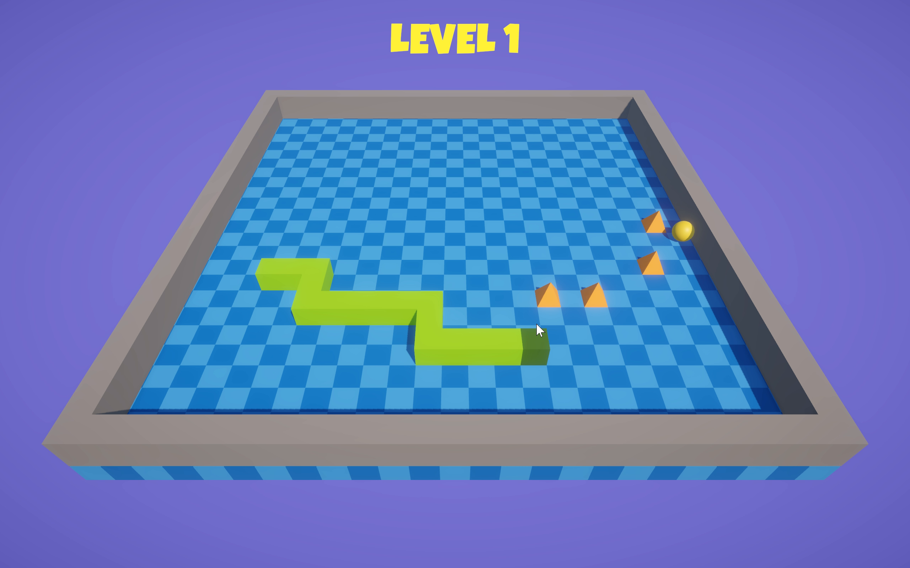
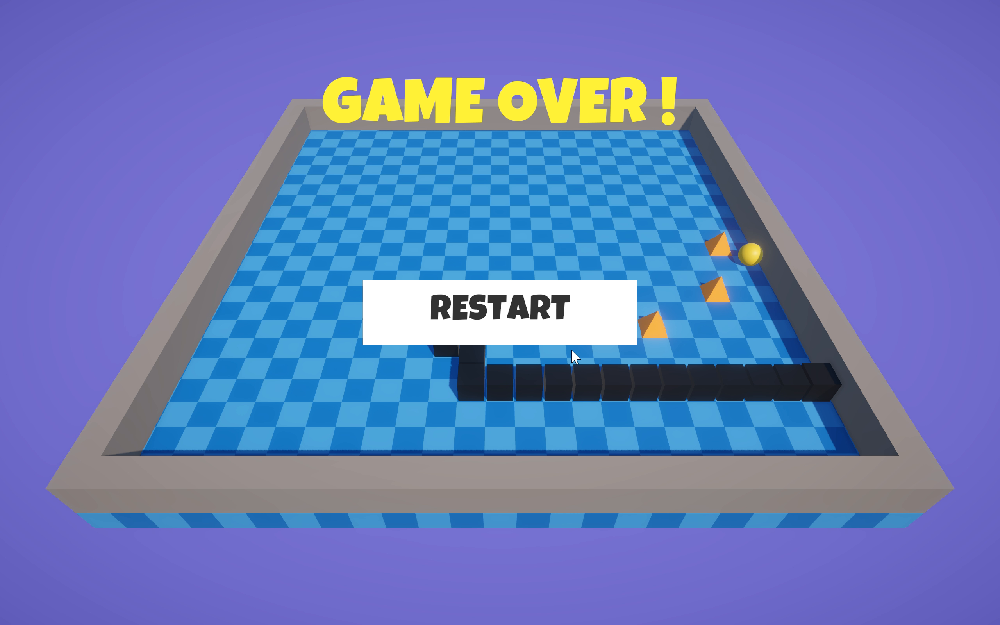

# 3D Snake — Unity

A modern 3D take on the classic Snake, built with **Unity 6** and the Universal Render Pipeline. Guide your snake around a walled arena, eat the food to grow longer, and weave between the spikes for as long as you can survive.

## Gameplay

- **Grow longer** — 1–2 pieces of food are on the board at any time; eat the last one and a fresh batch appears, always on a free tile.
- **Dodge the spikes** — hazards are scattered across the arena at the start of every run (never near your spawn, and never under food).
- **Don't crash** — hitting a wall, a spike, or your own body ends the run: the snake turns black and collapses onto the board, and you can restart instantly.

## Controls

| Key | Action |
|-----|--------|
| W | Move up |
| S | Move down |
| A | Move left |
| D | Move right |

## Screenshots

*Snake at length 13, threading between spikes:*

*Game over — the snake collapses where it crashed:*

## How it works

The game logic is fully **grid-based** — the snake is a list of integer cells, and movement, wall hits, self-collision, food pickup, and spike hits are all resolved with cell math. No Rigidbodies, colliders, or physics callbacks are used during play, which makes the gameplay deterministic and frame-rate independent. Physics is added only at the moment of death, purely for the collapse effect.

### Scripts (`Assets/Scripts`)

| Script | Responsibility |
|--------|----------------|
| `GameManager` | Game state (playing / game over), score, and end-of-game UI. Self-creating singleton — no scene setup needed. |
| `SnakeMovement` | The snake itself: buffered input (no 180° reversals), fixed-interval stepping, growth, and all collision checks. |
| `GenerateFloor` | Builds the checkerboard floor and border ring, and defines the playable bounds everything else reads. |
| `GenerateFood` | Keeps 1–2 foods on free tiles, spawn area derived from the floor bounds. |
| `GenerateSpike` | Scatters spike hazards on free tiles at the start of each run, with a safe zone around the spawn. |
| `Events` | UI button handlers (restart, menu, quit). |

## Running the project

1. Clone the repository.
2. Open the project folder in Unity (6000.2 or later) via Unity Hub.
3. Open `Assets/Scenes/Level.unity` and press Play.
